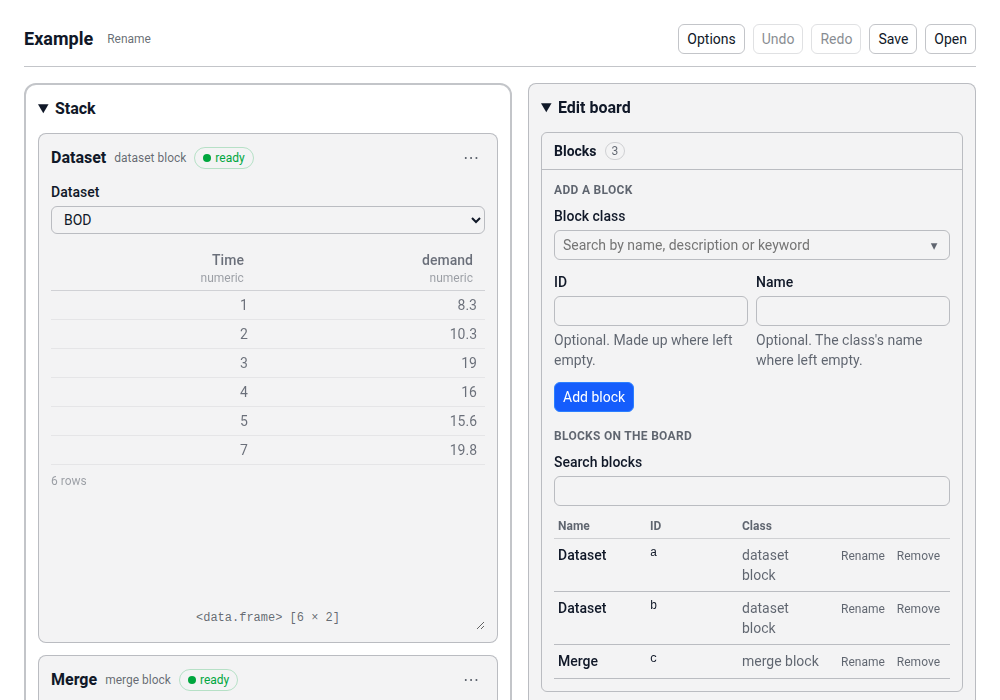
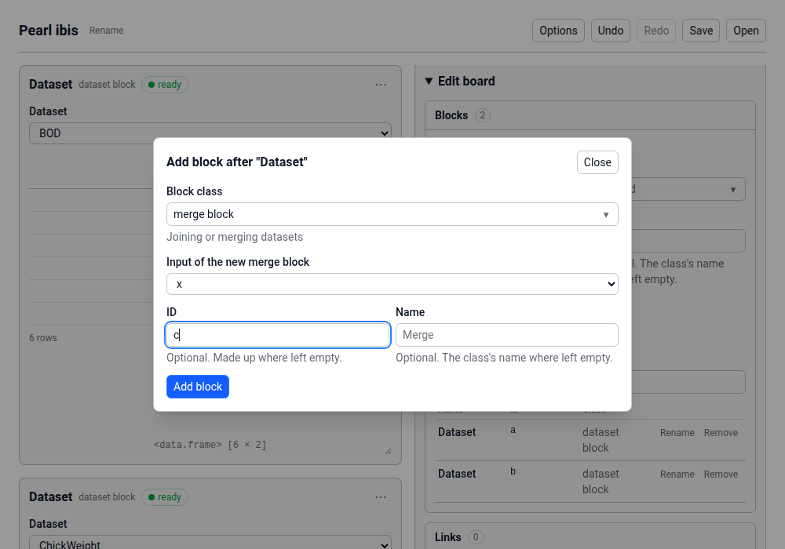
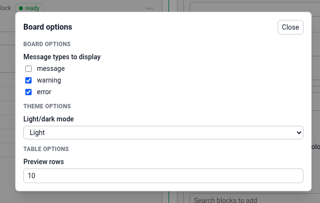
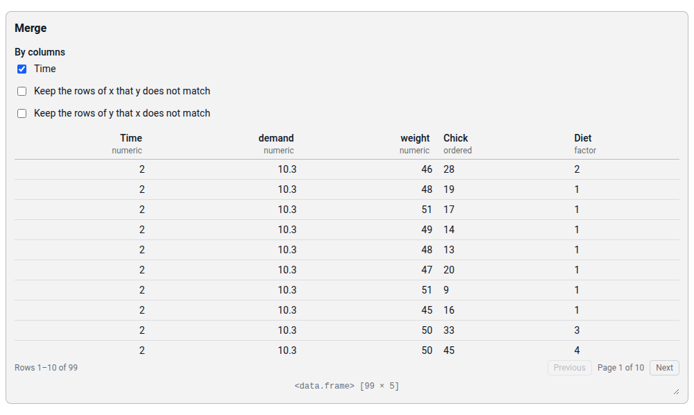

```{r, include = FALSE}
knitr::opts_chunk$set(
  collapse = TRUE,
  comment = "#>"
)
```

```{r setup}
library(blockr.core)
```

With blockr, a user analyzes and visualizes data in the browser, by pointing and clicking.
The analysis lives on a __board__.
A board holds __blocks__, each one step of the analysis, such as reading a dataset, joining two tables or drawing a plot.
A __link__ passes the result of one block to a data input of another, and a board's links never form a cycle.
A __stack__ groups blocks that belong together, such as the steps of one part of the analysis.

This board joins two datasets:

```{r, echo = FALSE}
include_mermaid("board-dag")
```

Block `a` reads the dataset `BOD`, and block `b` reads the dataset `ChickWeight`.
Block `c` merges the two by their column `Time`.
The link from `a` feeds the input `x` of block `c`, and the link from `b` feeds its input `y`.
The stack `ac` holds blocks `a` and `c`.

## Define a board

An app script builds a board with the constructors of its parts.
This script builds the board above:

```{r simple-board}
board <- new_board(
  blocks = c(
    a = new_dataset_block("BOD"),
    b = new_dataset_block("ChickWeight"),
    c = new_merge_block("Time")
  ),
  links = c(
    ac = new_link("a", "c", "x"),
    bc = new_link("b", "c", "y")
  ),
  stacks = list(ac = c("a", "c")),
  id = "example"
)

board
```

The names in `blocks` are the IDs of the blocks, by which links and stacks name them.
Each block comes from the constructor of its block class, such as `new_merge_block()`, which takes the block's state, here the column to join by.
A link names the block it comes from, the block it goes to and the data input it feeds.
An ID that a script leaves out is drawn at random, such as `calm_heron`, and a board without a name is named after its ID.
The script gives this board's ID, so that the page shows the same one each time it is built.

A board also holds __board options__, such as the number of rows that a table shows on a page, which a user changes while the app runs.
While the app runs, the browser holds the board, and R evaluates its blocks.

## Serve the board

The function `serve()` makes an app of the board:

```{r, eval = FALSE}
serve(board)
```

Run at the top level of a script or an R session, the call starts the app.
R writes the board as JSON once, and the browser opens it.
From then on, the browser holds the board and makes every change to it, and R evaluates its blocks.

```{r, echo = FALSE, fig.alt = "The page of the example board. A toolbar at the top holds the board's name and the buttons Options, Undo, Redo, Save and Open. Below it, the stack holds the cards of the blocks a and c, each with its inputs and a table of its result, and the Edit board plugin sits to the right."}

```

Core's basic frontend draws the page, wherever no other installed package gives a frontend, as blockr.dock does.
The page has three parts:

- The toolbar at the top shows the board's name, which Rename changes.
  Options opens the board options, and Undo and Redo take back an edit and make it again.
  Save downloads the board as a JSON file, and Open opens such a file in place of the board.
- Each block has a card, with the block's name, its class and its status, a menu behind ⋯, the block's inputs and its output.
  A stack holds the cards of its blocks, and collapses by its name.
- The Edit board plugin, to the right of the board, adds, renames and removes blocks, and adds, changes and removes links and stacks.

## Build a board in the browser

A user can build the same board by hand, on a board that starts empty:

```{r, eval = FALSE}
serve(new_board())
```

1. Under Blocks, in the Edit board plugin, the user types "dataset" in Block class, picks the dataset block, types `a` as its ID and clicks Add block.
   The block's card appears, and the user picks `BOD` in its Dataset dropdown.
2. The user adds a second dataset block in the same way, with the ID `b`, and picks `ChickWeight` in its card.
3. In the card of block `a`, the user opens the menu behind ⋯ and picks Add block after.
   In the form, the user picks the merge block as the class, keeps `x` as the input that block `a` feeds, types `c` as the ID and clicks Add block.
   The merge block appears with a link from block `a` into its input `x`.

```{r, echo = FALSE, fig.alt = "The form of Add block after, opened from the card of block a. It holds the block class, merge block, the input of the new merge block, x, the ID, c, and an empty name."}

```

4. Under Links, the user picks block `b` in From and block `c` in To, and clicks Add link.
   The link feeds `y`, the one input of block `c` that no link feeds yet.
5. In the card of block `c`, the user ticks `Time` under By columns, the column to merge by.
   Until then, the merge block reads invalid, since it has no column to merge by.
6. Under Stacks, the user picks blocks `a` and `c` in Blocks and clicks Add stack.

Options opens the board options: the severities of the conditions that the cards show, the light or the dark theme, and the rows on a page of a table.
The board holds the value of a board option only once the user sets one, and every other board option takes its default.

```{r, echo = FALSE, out.width = "66%", fig.alt = "The dialog of the board options, with Message types to display, where warning and error are ticked, Light/dark mode, set to Light, and Preview rows, set to 10."}

```

Save downloads the board as a JSON file.
Open reads such a file and opens its board in place of the one on the page, and `serve()` serves such a file by its path, as `serve("board.json")` does.

## Serve a single block

The author of a block class tries it out on a single block with fixed data, with no board around it:

```{r, eval = FALSE}
serve(
  new_merge_block("Time"),
  data = list(x = datasets::BOD, y = datasets::ChickWeight)
)
```

Each entry of `data` binds to the block's input of that name.
The page shows the block in a card of its own: its name, its inputs, its output and a line of its status.

```{r, echo = FALSE, fig.alt = "A merge block served alone, in a card with its name, the column Time ticked under By columns, and a table of the merged rows."}

```

## What's next

- [Create a block class](create-block.html) shows how a package writes a block class: its R side, its UI module in the browser and its tests.
- [Block expressions](block-expressions.html) shows how a block class builds the R code that a block runs.
- [Migration notes for app scripts](migration-notes.html) lists what changes for a script written for blockr.core 0.1.
